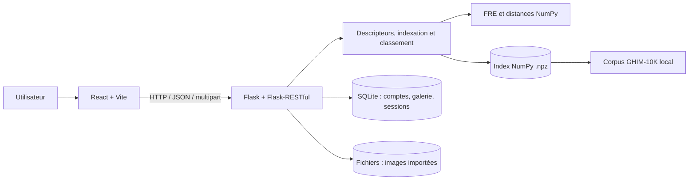

# Galerie CBIR — Groupe G13

Application web de gestion et de recherche d’images par leur contenu visuel (*Content-Based Image Retrieval*, CBIR). Le projet est réalisé dans le cadre du cours de M. M’hamed AIT KBIR.

La méthode de retour de pertinence attribuée au groupe **G13** est **Feature Relevance Estimation (FRE)**. Après une première recherche, l’utilisateur indique quelles images sont pertinentes. Le système estime alors le poids des caractéristiques visuelles et relance le classement.

> **En bref :** React et Vite pour l’interface, Python avec Flask et Flask-RESTful pour l’API, SQLite pour les données, Pillow et NumPy pour le traitement visuel. Le corpus GHIM-10K et les index générés sont des ressources locales et ne sont pas inclus dans Git.

## Sommaire

- [Fonctionnalités](#fonctionnalités)
- [Méthodes CBIR et descripteurs](#méthodes-cbir-et-descripteurs)
- [Architecture](#architecture)
- [Installation et lancement](#installation-et-lancement)
- [Indexation du corpus](#indexation-du-corpus)
- [Évaluation](#évaluation)
- [Documentation détaillée](#documentation-détaillée)
- [Références](#références)

## Fonctionnalités

- Inscription, connexion et session utilisateur.
- Import d’images à l’unité ou par lot, téléchargement et suppression individuelle ou groupée.
- Catégories hiérarchiques, filtre, tri, recherche par nom et déplacement groupé.
- Transformations non destructives : recadrage, redimensionnement, rotation, retournement, luminosité, contraste, saturation, netteté, niveaux de gris, sépia, flou et auto-contraste. L’aperçu précède la création d’une nouvelle image dérivée.
- Affichage des descripteurs visuels et analyse du fond (carte et masque lorsque la segmentation est jugée plausible).
- Recherche de similarité depuis une image importée, une image de la galerie ou une image du corpus.
- Feedback FRE itératif avec sélection des images pertinentes et affichage des distances.

## Méthodes CBIR et descripteurs

Chaque image est décrite par un vecteur de **329 dimensions** : histogramme HSV (48), moments RGB (9), trois couleurs dominantes avec leurs proportions (12), propriétés GLCM (4) et histogramme LBP (256). La couleur d’accent la plus vive est également calculée et affichée dans la fiche image, mais **elle ne fait pas partie du vecteur de recherche et ne modifie pas le classement**.

Les histogrammes sont transformés par racine carrée (embedding de Hellinger) et les caractéristiques scalaires sont standardisées à partir du corpus indexé. La recherche initiale utilise des poids égaux et trie les images par distance euclidienne quadratique pondérée normalisée, par ordre croissant.

Trois modes de traitement du fond peuvent être indexés :

| Mode | Traitement |
|---|---|
| `global` | Utilise toute l’image. C’est le mode par défaut et le mode de référence. |
| `variance` | Pondère les pixels selon la variance locale de blocs afin de moins laisser dominer les régions uniformes. |
| `adaptive` | Utilise un masque objet/fond lorsque les mesures de séparabilité le permettent ; sinon revient à la pondération par variance. |

FRE est calculée à chaque itération à partir des images pertinentes sélectionnées **dans les résultats courants**. Au moins deux images pertinentes sont nécessaires. Les retours négatifs sont acceptés par l’API, mais ne sont actuellement pas utilisés dans la formule de G13. Voir [Méthodes CBIR et FRE](docs/METHODS.md) pour les détails et les équations.

## Architecture



Le frontend peut être servi par Flask après compilation ou par le serveur de développement Vite. Les images personnelles sont stockées dans le système de fichiers; leurs métadonnées, catégories, comptes et sessions de recherche sont dans SQLite. L’index de recherche est un fichier NumPy compressé, pré-calculé séparément.

## Installation et lancement

Prérequis : Python 3.12 ou plus récent, Node.js et npm. Placez le dataset dans `GHIM-10K/`, avec un sous-dossier par catégorie.

### Windows (PowerShell)

```powershell
python -m venv .venv
.\.venv\Scripts\python.exe -m pip install -r requirements-dev.txt
Set-Location frontend
npm install
npm run build
Set-Location ..
.\.venv\Scripts\python.exe -m backend.services.indexing --dataset GHIM-10K --output instance\features.npz
.\.venv\Scripts\python.exe -m backend.app
```

Ouvrez <http://127.0.0.1:5000>. Pour le développement frontend, lancez `npm run dev` depuis `frontend/` dans un second terminal. Vite relaie `/api` et `/health` vers Flask sur le port 5000.

Les index `features_variance.npz` et `features_adaptive.npz` sont facultatifs. Pour les créer, relancez l’indexation avec `--mode variance` et `--output instance\features_variance.npz`, puis avec `--mode adaptive` et `--output instance\features_adaptive.npz`. L’application détecte ces fichiers au démarrage.

### Linux / macOS

```bash
python3 -m venv .venv
. .venv/bin/activate
python -m pip install -r requirements-dev.txt
cd frontend && npm install && npm run build && cd ..
python -m backend.services.indexing --dataset GHIM-10K --output instance/features.npz
python -m backend.app
```

La configuration accepte notamment `SECRET_KEY`, `DATABASE_PATH`, `UPLOAD_DIR`, `DATASET_DIR`, `CBIR_INDEX_PATH` et `SEARCH_SESSION_RETENTION_DAYS`. En dehors du développement local, configurez une clé secrète stable et n’exposez pas le serveur de développement Flask.

## Indexation du corpus

GHIM-10K est fourni par [Kaggle](https://www.kaggle.com/datasets/mcpython/ghim-10k). L’indexation parcourt les images prises en charge, extrait les 329 caractéristiques, ajuste la normalisation sur le corpus et écrit les chemins, étiquettes de catégorie, vecteurs et paramètres de normalisation dans `instance/features.npz`.

Le corpus et les données générées sont ignorés par Git. Ils ne doivent pas être ajoutés au dossier final du projet. Une image requête provenant du corpus est exclue de ses propres résultats.

## Évaluation

Une évaluation hors ligne compare Precision@K et Recall@K avant et après les itérations FRE. Les catégories de GHIM-10K servent de vérité de référence uniquement dans cette simulation; elles ne sont pas consultées lors d’une recherche normale. Le feedback simulé est limité aux résultats examinés; utiliser une fenêtre plus grande que K simule un oracle et doit être signalé.

```powershell
.\.venv\Scripts\python.exe -m backend.services.evaluation --queries 100 --top-k 10 --iterations 3 --seeds 42 43 44 45 46
```

La commande imprime le protocole et les métriques en JSON. Les résultats connus et leurs limites sont documentés dans [Évaluation](docs/EVALUATION.md). Ils ne remplacent pas une validation avec de vrais utilisateurs.

## Documentation détaillée

L’index des documents est dans [`docs/README.md`](docs/README.md). Il donne accès aux guides sur la stack, l’architecture, les méthodes, l’API, les problèmes traités et l’évaluation.

## Références

- Renuka Devi SM, [“Reweighing Strategies for Relevance Feedback in CBIR”](https://doi.org/10.17148/IJARCCE.2016.511118), *International Journal of Advanced Research in Computer and Communication Engineering*, vol. 5, no 11, 2016. Le PDF fourni au projet est dans [`docs/references/`](docs/references/).
- [Dataset GHIM-10K — Kaggle](https://www.kaggle.com/datasets/mcpython/ghim-10k).
- [Flask](https://flask.palletsprojects.com/), [Flask-RESTful](https://flask-restful.readthedocs.io/), [React](https://react.dev/) et [Vite](https://vite.dev/).
