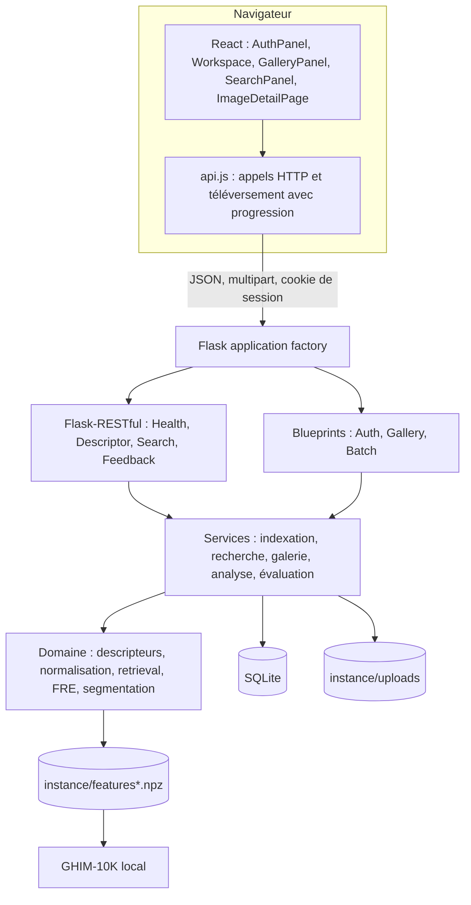

# Architecture logicielle

## Vue d’ensemble

## Responsabilités des dossiers

### Frontend — `frontend/src/`

- `App.jsx` gère l’état général et le parcours d’authentification.
- `components/Workspace.jsx` donne accès à la recherche, à la galerie et à l’importation/organisation.
- `SearchPanel.jsx` présente les résultats et collecte les votes de pertinence.
- `GalleryPanel.jsx` gère la navigation, le filtre, le tri et les opérations groupées.
- `ImageDetailPage.jsx` affiche les descripteurs, transformations et analyses du fond.
- `api.js` centralise les appels HTTP au backend.

### Backend — `backend/`

- `app.py` configure Flask, SQLite, les Blueprints et les ressources Flask-RESTful, puis charge les index disponibles.
- `routes/` valide les requêtes et applique l’authentification aux fonctions protégées.
- `services/` orchestre les opérations applicatives sans concentrer leur logique dans les composants UI.
- `domain/` contient les calculs CBIR/FRE, les modèles d’index et les méthodes d’analyse visuelle.
- `database/` crée le schéma SQLite et fournit les dépôts d’accès aux comptes, à la galerie et aux sessions.
- `utils/image_io.py` centralise les règles de lecture et de validation des fichiers image.

## Stockage

SQLite contient les tables `users`, `categories`, `images` et `search_sessions`. Chaque ressource de galerie est associée à un utilisateur. Les fichiers ne sont pas stockés en BLOB : SQLite conserve un nom de stockage aléatoire et des métadonnées, tandis que l’image se trouve sous `instance/uploads/`.

Le corpus GHIM-10K reste dans `GHIM-10K/`. L’index est un fichier `.npz` dans `instance/`; les variantes global, variance et adaptive sont chargées séparément quand elles sont présentes. Les sessions mémorisent l’utilisateur propriétaire, l’empreinte de l’index, le vecteur courant, les poids, les résultats et l’itération. Une session devenue incompatible après reconstruction de l’index doit être relancée.

## Parcours d’une recherche

1. Le navigateur envoie une image téléversée ou l’identifiant d’une image personnelle.
2. Le backend extrait son vecteur avec le même mode que l’index, puis applique le normaliseur sauvegardé dans cet index.
3. Le service classe les vecteurs avec des poids uniformes et exclut l’image elle-même si la requête provient de l’index.
4. Le backend persiste une session liée à l’utilisateur et renvoie les IDs, chemins, catégories et distances.
5. Après feedback, il vérifie la propriété de session et les IDs de l’itération courante, calcule les nouveaux poids et le nouveau vecteur requête, puis enregistre l’itération suivante.

## Erreurs et validation

Les routes contrôlent les formats, limites d’import, dimensions et valeurs numériques. Les erreurs d’API renvoient un objet JSON contenant `error` et un code HTTP. Les ressources privées ne sont accessibles qu’à la session du propriétaire.
